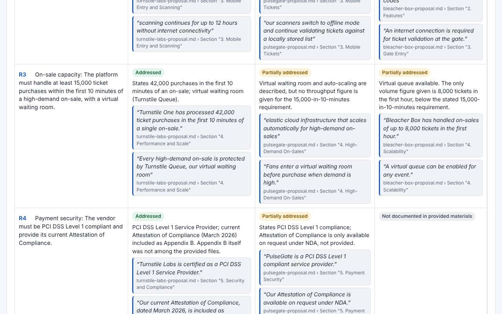

# VendorLens

VendorLens helps operations and procurement managers at sports teams, leagues and venues compare vendor proposals (ticketing, concessions, sponsorship, stadium tech) against their own requirements. You upload or paste your requirements and each vendor's proposal. VendorLens builds a table with one row per requirement and one column per vendor. Every claim in it comes with the file, the page or section, and a short quote copied word for word, which you can click to see in the original document. Anything a proposal leaves out is marked as a gap. VendorLens never picks a winner: it shows the evidence, and your team makes the decision.



## The four rules

1. **Closed evidence set.** Only the files you upload or paste are used. No web search, no browsing, no outside knowledge, no vendor contact.
2. **Every claim is traceable.** Each claim shows a source locator (file plus page or section) and a short quote copied word for word from that location. Every quote is checked against the source text before it is shown. A quote that can't be found is removed.
3. **Gaps are explicit.** Anything required but not addressed shows as **"Not documented in provided materials."**
4. **Humans decide.** No overall scores, rankings or recommendations. In live mode each vendor is analyzed in a separate request, so the model never sees vendors side by side.

The same rules are in the app: click **How it works** in the header.

## Quick start: the demo in 30 seconds

No setup and no API key needed.

1. Open the site (or run it locally, below).
2. Click **Load sample data**.
3. Click **Next: review requirements →**, then **Run comparison**.

The sample is a requirements document for a **fictional** arena (Harbor City Arena) and three **fictional** ticketing proposals. None of these companies exist.

| Vendor (fictional) | Deliberately missing |
|---|---|
| Turnstile Labs | Data ownership terms (R5) |
| PulseGate Ticketing | Support SLA (R6) |
| Bleacher Box | PCI DSS compliance (R4) and accessibility (R7) |

Demo mode shows precomputed results with **no API call**, and quotes are still checked against the files. It is available only while the sample data is unchanged. The sample files are in `src/samples/` and the precomputed results are in `src/demo/demoResults.json`.

## 5-minute demo script

The full script, with talking points and what the viewer sees at each step, is in **[docs/demo-script.md](docs/demo-script.md)**. Every step was checked in Chromium against the built app (see [Checking the docs](#checking-the-docs)).

| # | Click | You should see | Screenshot |
|---|---|---|---|
| 1 | **How it works** (header) | A panel with the four rules. Click again or press Escape to close it. | [01](docs/screenshots/01-how-it-works.jpg) |
| 2 | **Load sample data** | `harbor-city-requirements.md` and three vendors (Turnstile Labs, PulseGate Ticketing, Bleacher Box), each file tagged **Fictional sample** | [02](docs/screenshots/02-sample-loaded.jpg) |
| 3 | **Sections** on `turnstile-labs-proposal.md`, then **Section "6. Support"**, then **Close** | 11 section locators; the section's full text opens in a window | [03](docs/screenshots/03-sections.jpg) |
| 4 | **Next: review requirements →** | 10 requirements, **R1** to **R10**, each with a `Source:` link. **Demo mode** is selected. | [04](docs/screenshots/04-requirements.jpg) |
| 5 | **Run comparison** | The table with a **Demo mode: precomputed results** tag: 10 rows, 3 vendor columns, 47 quotes | [05](docs/screenshots/05-comparison.jpg) |
| 6 | The R1 Turnstile Labs quote "Turnstile One includes Turnstile Exchange, a fully integrated resale marketplace." | `turnstile-labs-proposal.md`, `Section "2. Resale Marketplace"`, with the quote highlighted in yellow | [06](docs/screenshots/06-quote-highlight.jpg) |
| 7 | Scroll through rows R4 to R7 | Exactly 4 grey **Not documented in provided materials** cells: Bleacher Box R4, Turnstile Labs R5, PulseGate Ticketing R6, Bleacher Box R7 | [07](docs/screenshots/07-gaps.jpg) |
| 8 | **Export CSV** | The note "**VendorLens does not pick a winner.**" above the table; `vendorlens-comparison.csv` downloads | [08](docs/screenshots/08-export.jpg) |
| 9 | (Optional) **← Back to requirements**, then edit R1 | **Demo mode** is greyed out ("Only available for the unmodified sample data."). Without live mode, **Run comparison** is disabled; with live mode on, **Live analysis** is selected instead. | [09](docs/screenshots/09-edited.jpg) |

## Local development

Tested with Node.js 22.

```bash
npm install
npm run dev       # start the UI at http://localhost:5173 (demo mode only)
npm test          # unit tests: quote verification, demo data, product rules, rate limit, passcode
npm run build     # production build into dist/
npm run preview   # serve the built dist/ at http://localhost:4173
```

`npm run build` runs `scripts/check-secrets.mjs` twice: before the Vite build it scans the source (`prebuild`), and after it scans `dist/` (`postbuild`). The build fails if anything that looks like an API key is found, or if any `ANTHROPIC_*` name ends up in the browser bundle. You can run both scans by hand with `npm run check-secrets`.

`npm run dev` and `npm run preview` don't run the Netlify Functions, so `/api/status` returns 404, the app treats live mode as off, and demo mode still works. To run the functions locally you need the Netlify CLI (`npx netlify dev`, with `ANTHROPIC_API_KEY` set in your shell). This local live setup has not been tested. The M1 report also notes that the production CSP may block Vite's dev-mode styles under `netlify dev`.

## Live mode setup

Live mode sends the requirements and one vendor's documents at a time to Claude through a Netlify Function (`netlify/functions/analyze.mjs`). The API key stays on the server. The browser only learns from `/api/status` whether live mode is on and whether a passcode is needed.

> **Status: live mode has not been tested end to end with a real API key yet**, and nothing has run on Netlify itself (PRD milestone M2). Demo mode is the tested path.

Set these in **Netlify → Project configuration → Environment variables**, each scoped to **Functions** only. Never commit them, and never give them a `VITE_` prefix (Vite copies `VITE_*` variables into the browser JavaScript).

| Variable | Required | Default | What it does |
|---|---|---|---|
| `ANTHROPIC_API_KEY` | For live mode | (unset: live mode off) | Your Anthropic API key, `<your key>`. Scope it to **Functions** only so the build never sees it. Without it, the site runs in demo mode only. |
| `ANTHROPIC_MODEL` | No | `claude-opus-5-5` | Model used for live analysis. |
| `ANTHROPIC_EFFORT` | No | `low` | Effort setting. `low` is meant to keep each vendor's analysis inside Netlify's 60-second streaming limit (not yet measured on Netlify). |
| `RATE_LIMIT_PER_HOUR` | No | `12` | Live vendor analyses allowed per IP address per hour. |
| `RATE_LIMIT_GLOBAL_PER_DAY` | No | `150` | Live vendor analyses allowed per day for the whole site. |
| `LIVE_PASSCODE` | No | (unset: no passcode) | Optional shared passcode for live mode (server-side only for now; **leave unset**, see below). When set, `/api/analyze` refuses live requests that don't carry the matching passcode. Use a long ASCII passphrase. Demo mode never needs it. |
| `PASSCODE_FAILS_PER_HOUR` | No | `10` | Wrong passcode attempts allowed per IP address per hour. After that, `/api/analyze` returns HTTP 429 with `"code": "passcode_locked"`. Scope it to Functions. Only matters when `LIVE_PASSCODE` is set. |

Notes:
- Rate-limit counters are stored in Netlify Blobs, so there's nothing extra to set up on Netlify. Since M4 the counter writes are atomic. If Blobs can't be reached, live analysis is refused (503) rather than running without a limit.
- Live analysis caps each vendor's documents at 250,000 characters.
- **Passcode contract:** `GET /api/status` returns `{"liveEnabled": boolean, "passcodeRequired": boolean}`. The browser sends the passcode on `POST /api/analyze` in the `X-VendorLens-Passcode` header. A missing or wrong passcode returns HTTP 401 with `"code": "passcode_required"`.
- **Passcode status: server-side only.** The server-side check and the `passcodeRequired` flag in `/api/status` are in place and unit-tested. The app has no passcode input yet and never sends the `X-VendorLens-Passcode` header, so with `LIVE_PASSCODE` set, every live analysis fails with "Live mode needs the site passcode. Enter it and try again, or use demo mode." After `PASSCODE_FAILS_PER_HOUR` wrong attempts (default 10) from one IP address in an hour, it returns HTTP 429 `passcode_locked`. Leave `LIVE_PASSCODE` unset until the input ships. This means PRD M4 test 2 ("it asks for the passcode") can't pass yet.

## Deploy to Netlify

Follow **[docs/netlify-checklist.md](docs/netlify-checklist.md)** step by step. In short:

1. In Netlify, choose **Add new project → Import an existing project → GitHub** and pick this repo.
2. Build settings come from `netlify.toml`: build command `npm run build`, publish folder `dist`, functions in `netlify/functions`.
3. Set the production branch to **`main`**. Production deploys from `main`. Turn on deploy previews so every PR gets a preview URL.
4. Add `ANTHROPIC_API_KEY` scoped to Functions only (and any optional variables above), then trigger a new deploy. Variable changes only apply to new deploys. Without the key, the site still works in demo mode.
5. Check the deploy log for two `check-secrets: OK.` lines, and check `<site URL>/api/status`.

`netlify.toml` also sets the security headers (Content-Security-Policy, `X-Frame-Options: DENY`, `Referrer-Policy: no-referrer` and others).

## Supported files

- **PDF**: located by page. Scanned PDFs with no text layer are rejected and need OCR first.
- **DOCX**: located by heading.
- **TXT / MD**: located by heading, or by line range if there are no headings.
- **Pasted text**: Markdown headings (`## Section`) become section locators.

In the requirements document, lines starting with an ID such as `R1.` become requirements. If there are none, numbered or bulleted lines are used. You can edit, add or remove requirements before running the comparison.

## Limitations

- **Live mode is untested end to end** with a real key, and nothing has been verified on Netlify yet: Functions, Blobs, the atomic rate limit, and the 60-second streaming limit (PRD risk R-1).
- **Only the Markdown samples have been tested.** Real-world PDFs and DOCX files have not been checked yet.
- **The live-mode passcode has no input in the app yet** (see the passcode status above). Without a passcode, anyone with the URL can use the live quota, up to the rate limits (R-4).
- **Effort is `low`** to fit Netlify's 60-second limit, which may lower recall on long or subtle proposals (R-2).
- **A quote can be verbatim and still not support the claim.** VendorLens checks that each quote exists at its location, not that it proves the summary (R-8). Click through to check important cells.
- **Work is lost on page refresh** (R-5).
- **Scanned PDFs** are not supported (no OCR) (R-6).
- Some text files with short numbered list items can get odd section locators (R-7).
- Demo mode only works for the unchanged sample data.

## How this was built

VendorLens v0.1 was built in a Claude Code session. The remaining milestones are done by build-time sub-agents defined in `.claude/agents/`, following [docs/PRD.md](docs/PRD.md). These agents run only while the app is being built. They are not part of the app, which makes at most one Claude call per vendor in live mode and none in demo mode.

| Agent | Role | Milestones |
|---|---|---|
| [`deploy-security-reviewer`](.claude/agents/deploy-security-reviewer.md) | Netlify config, security headers, secret scanning, rate limit and passcode | M1, M4 (security) |
| [`live-mode-tester`](.claude/agents/live-mode-tester.md) | End-to-end live tests, timing and effort tuning, failure handling | M2 (optional, not run yet) |
| [`frontend-ui`](.claude/agents/frontend-ui.md) | UI polish, saving work, accessibility | M3 (optional, not run yet) |
| [`qa-evidence-auditor`](.claude/agents/qa-evidence-auditor.md) | Independent gate: quote verification, demo data, no-winner rule; PASS or BLOCK | After every milestone |
| [`docs-demo`](.claude/agents/docs-demo.md) | README, demo script, screenshots, "How it works" panel | M4 (docs) |

Reports so far:
- [M1: deploy-security-reviewer](docs/reports/M1-deploy-security-reviewer.md)
- [M1: qa-evidence-auditor (PASS)](docs/reports/M1-qa.md)
- [M4: deploy-security-reviewer](docs/reports/M4-deploy-security-reviewer.md)
- [M4: docs-demo](docs/reports/M4-docs-demo.md)

## Checking the docs

Two scripts in `docs/scripts/` keep this README and the demo script honest:

```bash
# Every process.env variable in netlify/ is in the table above, and every README link resolves.
node docs/scripts/check-docs.mjs

# Walk every demo-script step in Chromium against the built app and refresh the screenshots.
npm run build && npx vite preview --port 4173 --strictPort &
node docs/scripts/check-demo-script.mjs http://localhost:4173/
```

The browser check needs Playwright. If it isn't installed as `playwright`, set `PLAYWRIGHT_MODULE` to its entry file, and set `CHROMIUM_PATH` to a Chromium binary if needed.
