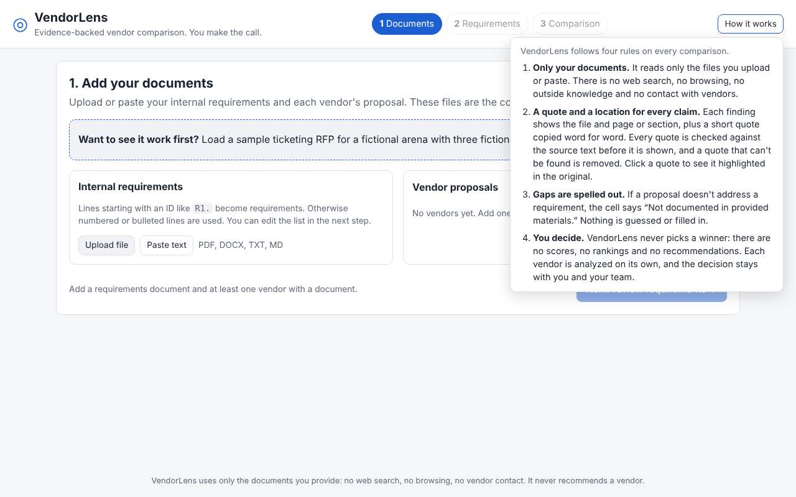
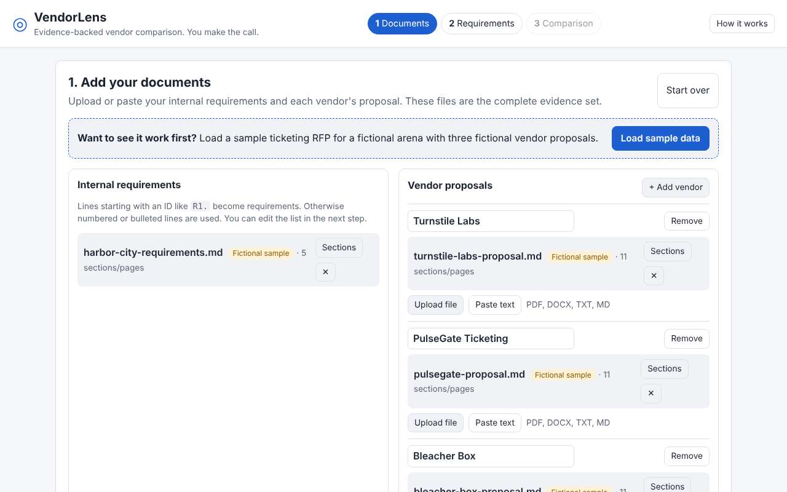
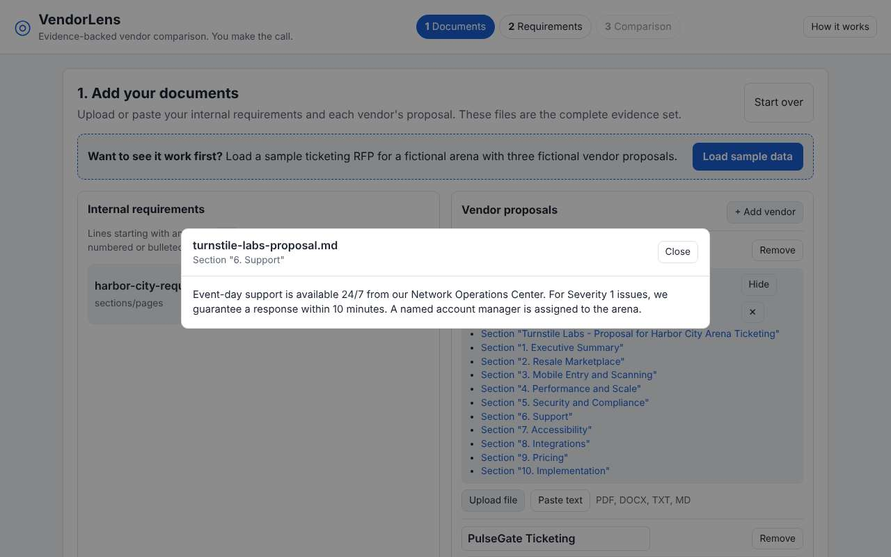
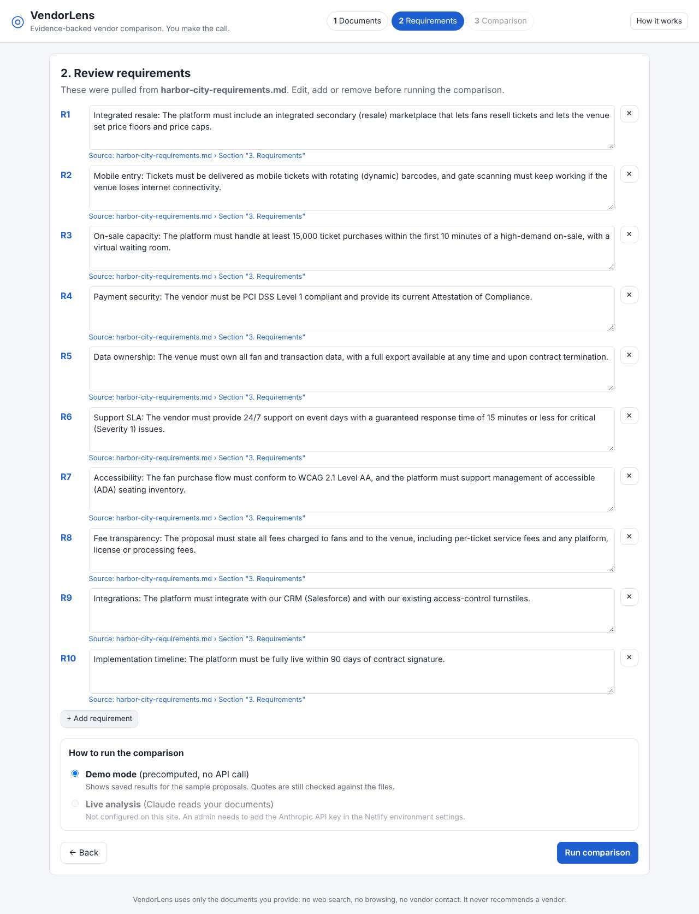
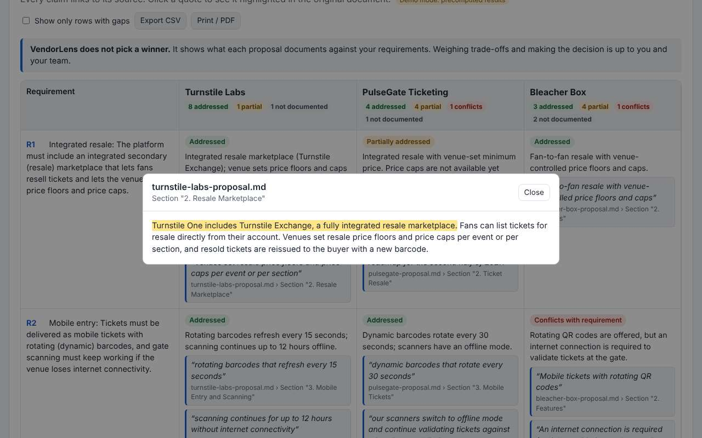
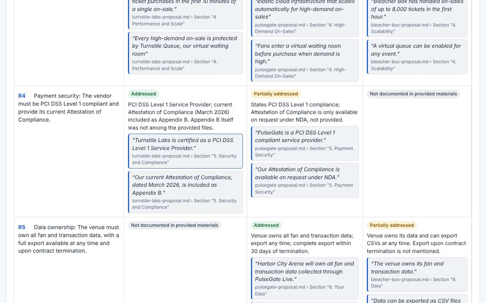
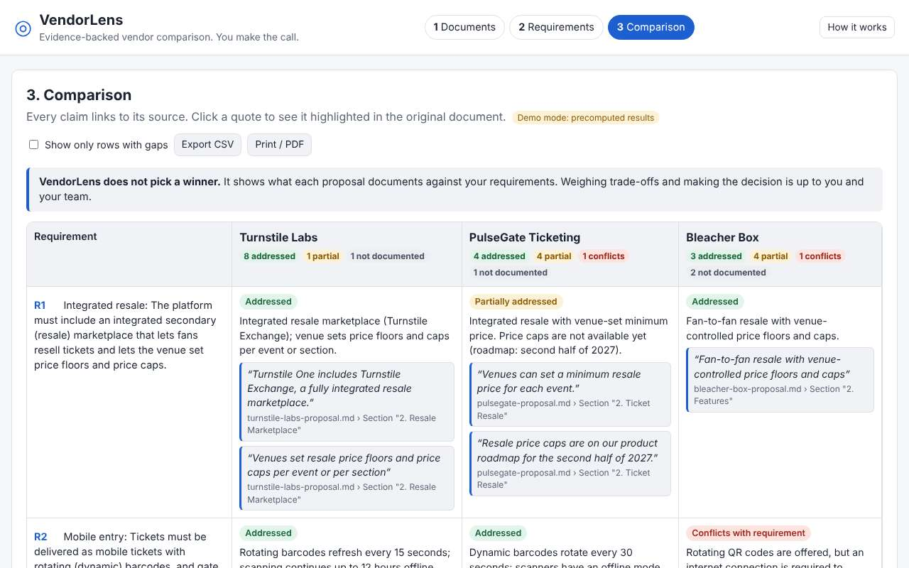
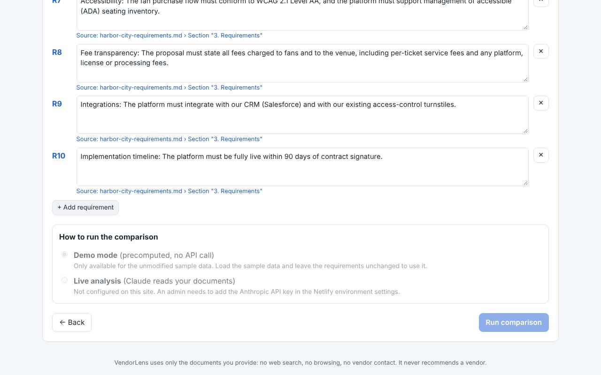

# VendorLens 5-minute demo script

This script runs in **demo mode**: precomputed results for fictional sample data, with no API call and no API key needed. It works on the production site, on a deploy preview, or locally with `npm run dev`.

All the companies in the sample (Harbor City Arena, the Harbor City Gulls, Turnstile Labs, PulseGate Ticketing and Bleacher Box) are **fictional**.

Each step lists what you click, what you say, and what the viewer sees. Button labels are in **bold** and match the app exactly. Every step was checked in Chromium by `docs/scripts/check-demo-script.mjs` (see [the M4 report](reports/M4-docs-demo.md)).

| Step | Time |
|---|---|
| 1. Open the app and the "How it works" panel | 0:00 to 0:40 |
| 2. Load the sample data | 0:40 to 1:10 |
| 3. Show section locators | 1:10 to 1:40 |
| 4. Review the 10 requirements | 1:40 to 2:20 |
| 5. Run the comparison | 2:20 to 2:50 |
| 6. Click a quote | 2:50 to 3:30 |
| 7. Point out the gaps | 3:30 to 4:10 |
| 8. No winner, then export | 4:10 to 4:40 |
| 9. (Optional) Demo mode turns off after an edit | 4:40 to 5:00 |

---

### 1. Open the app and the "How it works" panel
- **Do:** Open the site. In the header, click **How it works**.
- **Say:** *"This is VendorLens. It compares vendor proposals against our requirements using only the documents we give it. These are its four rules."*
- **Viewer sees:** The header shows the steps **1 Documents**, **2 Requirements**, **3 Comparison** and a **How it works** button. The panel opens with four rules: "Only your documents.", "A quote and a location for every claim.", "Gaps are spelled out." and "You decide."
- **Then:** Click **How it works** again (or press Escape) to close it.

### 2. Load the sample data
- **Do:** Click **Load sample data**.
- **Say:** *"Three fictional ticketing vendors and our fictional arena's requirements."*
- **Viewer sees:** Under **Internal requirements**, `harbor-city-requirements.md`. Under **Vendor proposals**, three vendors (Turnstile Labs, PulseGate Ticketing, Bleacher Box), each with one proposal file. Every file has a **Fictional sample** tag and shows "11 sections/pages" (the requirements file shows "5 sections/pages").

### 3. Show section locators
- **Do:** On `turnstile-labs-proposal.md`, click **Sections**. Then click **Section "6. Support"**.
- **Say:** *"Every document is split into sections or pages. That's how each claim later points to an exact location."*
- **Viewer sees:** A list of 11 locators: the proposal title, then `Section "1. Executive Summary"` through `Section "10. Implementation"`. Clicking one opens the full text of that section in a window titled with the file name and locator.
- **Then:** Click **Close**.

### 4. Review the 10 requirements
- **Do:** Click **Next: review requirements →**.
- **Say:** *"It pulled out 10 requirements from our document, and each one links back to where it came from. I can edit, add or remove them."*
- **Viewer sees:** "2. Review requirements" with 10 editable requirements, **R1** to **R10** (integrated resale, mobile entry, on-sale capacity, payment security, data ownership, support SLA, accessibility, fee transparency, integrations, implementation timeline). Each has a link `Source: harbor-city-requirements.md › Section "3. Requirements"`. Under **How to run the comparison**, **Demo mode** (precomputed, no API call) is selected.
- **Note:** If live mode isn't set up on the site, the **Live analysis** option is greyed out and says "Not configured on this site." That's expected, and the demo doesn't need it.

### 5. Run the comparison
- **Do:** Click **Run comparison**.
- **Say:** *"Every claim has a quote and a location."*
- **Viewer sees:** "3. Comparison" with a **Demo mode: precomputed results** tag. The table has one row per requirement (R1 to R10) and one column per vendor. Each cell shows a status (Addressed, Partially addressed, Conflicts with requirement, or Not documented in provided materials). Cells with evidence also show a one-line summary and one or more quotes, each with its file and locator. There are 47 quotes in total. Each vendor's column header shows its status counts, for example Turnstile Labs shows 8 addressed, 1 partial and 1 not documented.

### 6. Click a quote
- **Do:** In row **R1** (integrated resale), Turnstile Labs column, click the quote "Turnstile One includes Turnstile Exchange, a fully integrated resale marketplace."
- **Say:** *"Here's that sentence, highlighted in the vendor's own proposal. Every quote is checked word for word against the source before it's shown."*
- **Viewer sees:** A window titled `turnstile-labs-proposal.md`, `Section "2. Resale Marketplace"`, with the quoted sentence highlighted in yellow.
- **Then:** Click **Close** (or press Escape).

### 7. Point out the gaps
- **Do:** Scroll down through rows R4 to R7 and point to the four grey **Not documented in provided materials** badges. (Rows are tall, so they don't all fit on one screen.)
- **Say:** *"When a proposal doesn't cover something, VendorLens says so instead of guessing. Turnstile never mentions data ownership, PulseGate has no support SLA, and Bleacher Box documents neither PCI DSS compliance nor accessibility."*
- **Viewer sees:** Exactly four "Not documented in provided materials" cells:

  | Requirement | Vendor |
  |---|---|
  | R4 Payment security (PCI DSS) | Bleacher Box |
  | R5 Data ownership | Turnstile Labs |
  | R6 Support SLA | PulseGate Ticketing |
  | R7 Accessibility | Bleacher Box |

  These cells have no quote, because there is nothing in the documents to quote.

### 8. No winner, then export
- **Do:** Point to the box above the table, then click **Export CSV**.
- **Say:** *"Notice there's no score or winner. That decision stays with us. I can export the evidence for the team."*
- **Viewer sees:** The note "**VendorLens does not pick a winner.** It shows what each proposal documents against your requirements. Weighing trade-offs and making the decision is up to you and your team." The browser downloads `vendorlens-comparison.csv`, with one row per quote plus one row for each "Not documented" cell (51 rows for the sample). **Print / PDF** next to it opens the print dialog.

### 9. (Optional) Demo mode turns off after an edit
- **Do:** Click **← Back to requirements** and type a word into **R1**.
- **Say:** *"The saved results only match the unchanged sample. As soon as I edit a requirement, demo mode switches off, and a real comparison would need live analysis."*
- **Viewer sees:** The **Demo mode** option is greyed out and says "Only available for the unmodified sample data." On a site without live mode, **Run comparison** is disabled. On a site with live mode on, **Live analysis** is selected instead; don't click **Run comparison** unless you mean to make real API calls. To get demo mode back, go to **1 Documents** and click **Load sample data** again.

---

## Tips for presenting
- Use a laptop-sized window (about 1280 px wide) so all three vendor columns fit without scrolling sideways.
- Live analysis is **not** part of this script. It needs the Netlify setup in the README, and it has not yet been tested end to end with a real API key.
